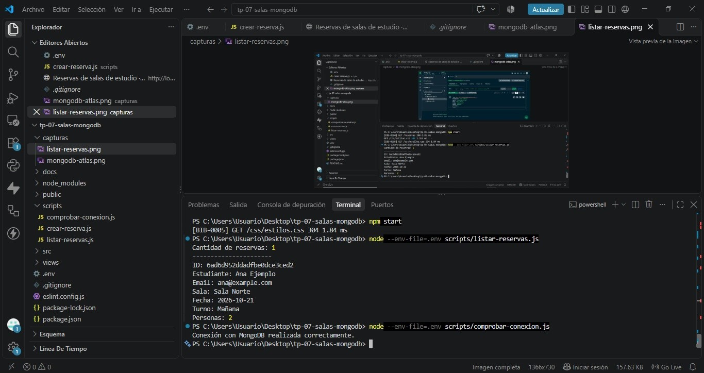
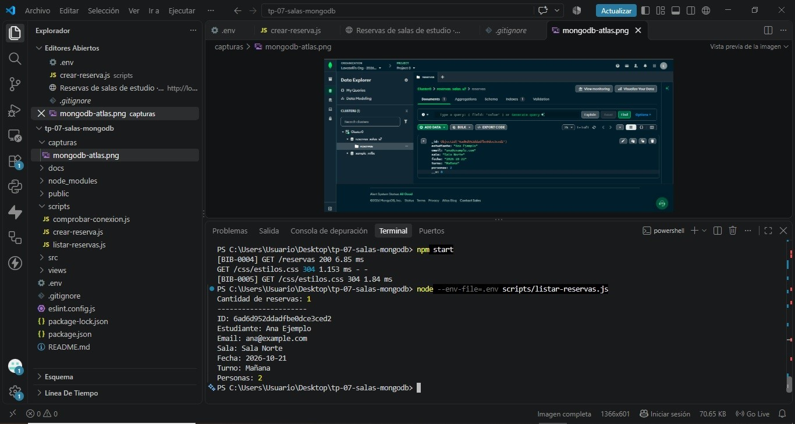
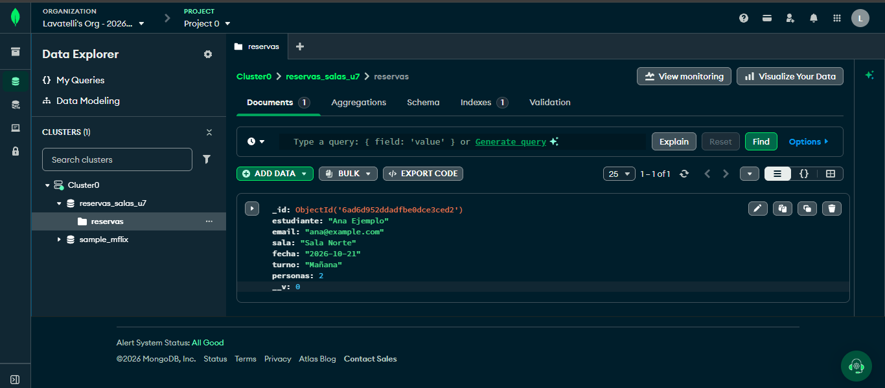

# TP 07 - Persistencia inicial de reservas de salas

## ¿De dónde sale este proyecto?

Este trabajo es una **copia de mi TP 06**, llamada `tp-07-salas-mongodb`.
El sitio original sigue igual y conserva sus reservas en memoria. En esta unidad agregué MongoDB para practicar desde la terminal. Recién en el TP 08 el sitio pasará a usar MongoDB.

Proyecto con Node.js (usar versión compatible con `--env-file`), Express 5, CommonJS y Mongoose 8. En las pruebas se utilizó **MongoDB Atlas Free (M0)**. Versiones declaradas en `package.json`: Express `^5.2.1`, Mongoose `^8.19.1`, Prettier `^3.6.2` y ESLint `^9.39.1`. La versión concreta de Node.js y las versiones instaladas se pueden consultar con `node -v` y `npm ls express mongoose`.

## Cómo preparar el proyecto

1. Abrir esta carpeta en Visual Studio Code y abrir una terminal.
2. Ejecutar `npm install` para instalar las dependencias, incluida Mongoose. Este comando también actualiza `package-lock.json` si fuera necesario.
3. Entrar a [MongoDB Atlas](https://www.mongodb.com/cloud/atlas) y crear un proyecto y un clúster **Free M0**, si no hay uno.
4. En **Database Access** crear un usuario de base de datos con permisos de lectura y escritura.
5. En **Network Access** agregar la IP desde la que voy a conectarme. Usar las opciones autorizadas para la práctica.
6. En **Connect > Drivers > Node.js**, copiar la URI de conexión.
7. Copiar `.env.example` a un archivo nuevo llamado `.env`.
8. En `.env` reemplazar `USUARIO`, `CLAVE` y `HOST` con datos reales. Usar la base `reservas_salas_u7` en la dirección. La contraseña con caracteres especiales puede requerir codificación URL.
9. **No subir `.env` a GitHub ni mostrar capturas de la URI real.**

### Comandos de la terminal

```bash
node --env-file=.env scripts/comprobar-conexion.js
node --env-file=.env scripts/listar-reservas.js
node --env-file=.env scripts/crear-reserva.js
node --env-file=.env scripts/listar-reservas.js
node --env-file=.env scripts/listar-reservas.js
npm run format
npm run check
npm start
```

El programa de conexión solo comprueba el acceso y termina. El de creación guarda **una reserva nueva** en cada ejecución y muestra su `_id`. Los listados no crean reservas. `npm start` ejecuta la página web del TP 06, que todavía trabaja en memoria y no necesita Atlas.

## Archivos importantes

- `src/config/entorno.js`: lee y valida puerto y URI.
- `src/config/base-datos.js`: configura DNS, abre y cierra la conexión.
- `src/modelos/reserva.js`: define los campos y sus validaciones con Mongoose.
- `scripts/comprobar-conexion.js`: prueba la conexión sin escribir.
- `scripts/crear-reserva.js`: escribe una reserva ficticia.
- `scripts/listar-reservas.js`: busca y muestra las reservas guardadas.
- `src/index.js`, `src/app.js` y demás archivos anteriores: continúan con el sitio en memoria.

## Campos del modelo

| Campo | Regla |
| --- | --- |
| estudiante | Texto obligatorio, sin espacios a los lados |
| email | Texto obligatorio, con `@` |
| sala | Sala Norte, Sala Sur o Sala Multimedia |
| fecha | Texto obligatorio no vacío |
| turno | Mañana, Tarde o Noche |
| personas | Número entero entre 1 y 6 |

La colección se llama `reservas` y pertenece a la base `reservas_salas_u7`. MongoDB crea un `_id` de tipo ObjectId. Tener un `_id` en un objeto todavía no prueba que se haya guardado: para confirmarlo esperamos `Reserva.create()` y después lo volvemos a consultar desde otro proceso.

En este TP **no** validamos fechas reales/futuras, correo completo, superposición de turnos, cupos compartidos ni duplicados. Dos ejecuciones de creación válida pueden dejar dos reservas iguales con identificadores distintos.

## DNS y problemas frecuentes

La configuración de clase usa `dns.setServers(["8.8.8.8", "1.1.1.1"])` **solo dentro de** `src/config/base-datos.js`. Ayuda a resolver registros SRV/TXT en redes que lo permiten, pero no arregla contraseñas ni IPs sin autorización. Si la red bloquea esos DNS, consultar al docente y documentar el cambio permitido. Los errores muestran tipo y, si está disponible, código y operación, sin publicar la URI.

## Pruebas y evidencias realizadas

En mi computadora configuré MongoDB Atlas Free M0 y probé los scripts desde la terminal de Visual Studio Code. No incluyo contraseñas ni mi URI privada.

### Conexión

Primero me apareció `MongoServerError` con código `8000` al conectar. Revisé las credenciales y luego obtuve:

```text
Conexión con MongoDB realizada correctamente.
```

Este error fue de autenticación; no lo anoté como fallo de DNS.

### Creación y persistencia

Ejecuté:

```bash
node --env-file=.env scripts/crear-reserva.js
```

La terminal mostró:

```text
Reserva guardada correctamente.
ID: 6ad6d952ddadfbe0dce3ced2
```

Luego ejecuté un programa distinto:

```bash
node --env-file=.env scripts/listar-reservas.js
```

El resultado fue **1 reserva** con el mismo identificador. Sus datos fueron:

- Estudiante: Ana Ejemplo
- Email: ana@example.com
- Sala: Sala Norte
- Fecha: 2026-10-21
- Turno: Mañana
- Personas: 2

En MongoDB Atlas, dentro de `reservas_salas_u7` > `reservas`, encontré **1 documento** con el mismo `_id`: `6ad6d952ddadfbe0dce3ced2`. Guardé una captura de Data Explorer como evidencia. Esto comprueba que la reserva se recuperó desde otro programa y quedó guardada en la base.

**Cantidad inicial antes de crear:** no quedó documentada. **Cantidad después de crear:** 1. **Recuento sin crear después del rechazo de estudiante:** 1. No invento un recuento anterior a la creación ni resultados que no registré.

### Pruebas de errores

Para probar las validaciones, cambié de a un campo el objeto `datosReserva` de `scripts/crear-reserva.js` y ejecuté el script.

| Prueba | Resultado esperado | Resultado observado / evidencia |
| --- | --- | --- |
| Conexión correcta | Conecta y termina | Correcto: mensaje de conexión exitosa |
| Fallo de autenticación | No conecta | Ocurrió inicialmente el error `MongoServerError` código 8000; se corrigió y luego conectó |
| URI vacía | Error de configuración | Falta prueba documentada |
| Fallo DNS | Registrar código si ocurrió | No se observó en las evidencias compartidas |
| Listado inicial | Mostrar cantidad | No se registró la cantidad previa a crear |
| Reserva válida | Guarda y devuelve ID | Correcto, ID mostrado arriba |
| Consulta desde otro proceso | Recuperar ID | Correcto, cantidad 1 y mismo ID |
| Consulta repetida | No crear más registros | Recuento adicional pendiente de documentar expresamente |
| Estudiante vacío | Rechazar | `Hay datos inválidos en la reserva. Revisar: estudiante`. La cantidad siguió siendo 1 |
| Email sin @ | Rechazar | `Hay datos inválidos en la reserva. Revisar: email` |
| Sala inválida | Rechazar | Prueba realizada según registro de trabajo; falta conservar salida individual |
| Turno inválido | Rechazar | Prueba realizada según registro de trabajo; falta conservar salida individual |
| Fecha vacía | Rechazar | Prueba realizada según registro de trabajo; falta conservar salida individual |
| Personas 0, 7 y 2.5 | Rechazar por separado | Pruebas realizadas según registro de trabajo; faltan salidas individuales |
| Personas `"abc"` | Error de conversión | Prueba realizada según registro de trabajo; falta salida individual |
| Inicio, `/reservas`, `/estado` | Funcionan como TP 06 | Comprobados en navegador según registro de trabajo |
| `npm run format` | Sin errores | Completado según registro de trabajo |
| `npm run check` | Sin errores | Completado según registro de trabajo |
| Formulario web válido e inválido | Redirección y 400 | Falta evidencia individual |
| CSS y ruta inexistente | CSS cargado y 404 | Falta evidencia individual |

**Pruebas pendientes antes de entregar:** completar las comprobaciones no documentadas, guardar capturas de las pruebas inválidas con la cantidad antes/después y verificar que el ejemplo de `crear-reserva.js` haya quedado otra vez con datos válidos. No se debe borrar la reserva para repetir la demostración.

### Evidencias sugeridas para la entrega

Guardar en `docs/` capturas recortadas, sin secretos, de: conexión correcta, creación con ID, listado desde otro proceso, listado repetido y documento con el mismo ID en Atlas. Para los errores, incluir las salidas de los casos que se hayan probado. Si se hacen nuevas pruebas, actualizar la tabla anterior con los resultados realmente obtenidos.

## Comparación con TP 06 y siguiente paso

En TP 06 todas las reservas del sitio eran un arreglo en memoria y los IDs eran números. En TP 07 ese sitio se conserva, pero añadimos **otro camino separado**: Mongoose guarda reservas en MongoDB desde programas de terminal, con ObjectId. En TP 08 se modificará el servicio web para que use la misma base persistente.

## Antes de entregar

Subir a un repositorio individual de GitHub este código, el `package.json`, **el lockfile actualizado después de `npm install`**, `.env.example`, README y las evidencias reales disponibles. No subir `.env`, `node_modules`, `.git` anterior ni credenciales. Compartir al profesor la URL del repositorio.

## Capturas de las pruebas

### Conexión con MongoDB


### Listado de reservas


### Reserva guardada en MongoDB Atlas

